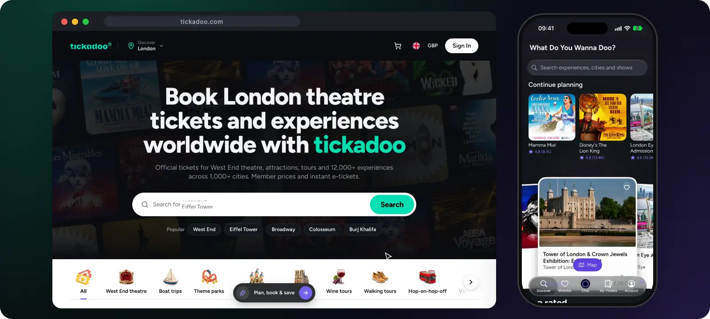
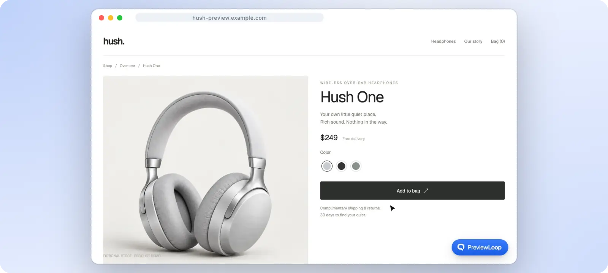
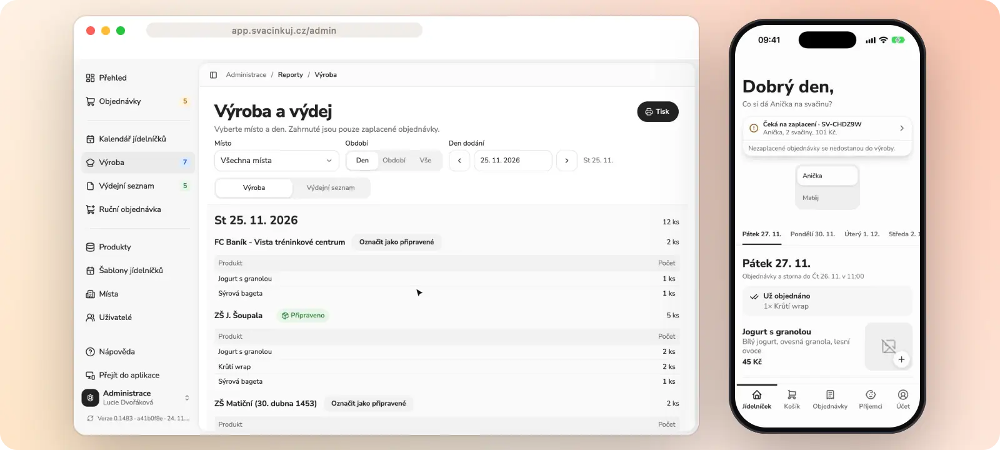

### Product engineer with frontend roots, building across web, iOS, and backend.

#### What I'm focused on right now

- **[tickadoo](https://www.tickadoo.com)**: Web and [iOS App](https://apps.apple.com/us/app/tickadoo-shows-attractions/id6786189935) ticketing platform, AI-powered discovery and personalization, booking flows and a seatmap editor PWA for venues.

  

- **[PreviewLoop](https://previewloop.com)**: Website feedback with screenshots, annotations, and AI in the loop. Built to save myself time going back and forth on changes with clients.

  

- **Draculino**: A website and CMS for the Brazilian jiu-jitsu Academy I train at, with 16 branches across the Czech Republic.

- **[Svačinkuj](https://svacinkuj.cz)**: The boring, but useful stuff. Snack ordering PWA for schools, clubs and companies - parents order for their kids, payments via Comgate (card, Apple Pay, Google Pay) or account credit, invoices, emails, and print-ready production and distribution lists so the kitchen knows what to prepare.

  

#### Stuff I work with

TypeScript · React · SolidJS · Astro · Swift · SwiftUI  
Cloudflare Workers · Hono · PostgreSQL / Neon · D1 · Drizzle · Payload CMS

#### Get in touch

[LinkedIn](https://www.linkedin.com/in/kolarskydominik/) · [Email](mailto:kolarskydominik@gmail.com)
